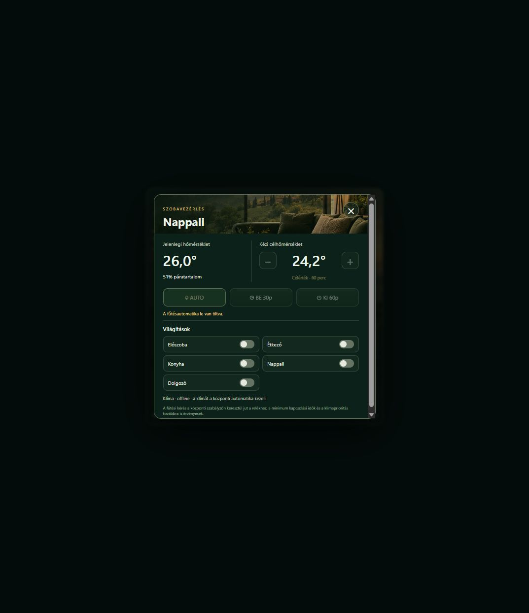

# Node-RED HVAC és napi riport – 2026. októberi rendszer

Ez a repository az otthoni Node-RED rendszer **HVAC Core** és **Datacollecting & Summary mailer** lapjának 2026. október 18-i, anonimizált exportja. A korábbi állapot külön [archív repositoryban](https://github.com/davidszabok/node-red-hvac-reporting-legacy) érhető el.

Az új változat a szezonális padlófűtés és klíma közötti választást, a külső szobaszenzorral vezérelt klímafűtést, a fürdő páravezérelt szellőztetését, valamint az adatgyűjtés és a napi riport bővített ellenőrzését tartalmazza. A napi összefoglaló Budapest időzónában 08:05-kor készül.

## Dutch Turf az NSPanelen

Az alábbi, korábbi ellenőrzési képernyőkép a Dutch Turf szobavezérlési felugró paneljét mutatja. A képen a fűtésautomatika ideiglenesen szünetelt.

## Tartalom

- [`flows/hvac-and-reporting.public.json`](flows/hvac-and-reporting.public.json): a két összetartozó flow-lap és az általuk használt konfigurációs node-ok.
- [`sql/schema.sql`](sql/schema.sql): a meglévő pillanatkép- és `live_snapshot` táblák mintasémája.
- [`sql/schema-v2.sql`](sql/schema-v2.sql): a döntésnapló és a gyűjtési ciklusok két további táblája.

## Importálás

1. A jelenlegi Node-RED rendszeredről készíts teljes mentést. A flow-t először elkülönített példányba importáld, vagy tiltsd le az összes fizikai kimenetet.
2. Telepítsd a szükséges Node-RED csomagokat: `node-red-contrib-ihost`, `node-red-contrib-dirigera`, `node-red-contrib-uibuilder`, `node-red-contrib-melcloud`, `node-red-node-email`, `node-red-node-mysql`, `node-red-contrib-google-sheets`.
3. Üres adatbázison hozd létre a táblákat a két SQL-fájllal. Meglévő adatbázisnál előbb hasonlítsd össze a tényleges táblákat, és készíts mentést.
4. Importáld a JSON-t a Node-RED szerkesztőben. Állítsd be az iHost-, DIRIGERA-, MELCloud-, MySQL-, Google Sheets- és SMTP-kapcsolatot.
5. Keress rá az összes `REPLACE_WITH_`, `example.com` és `192.0.2.10` mintára. Az eszközazonosítókat a Function node-ok saját térképeiben is pótolni kell. A helyi webes végpontokat, időjárási koordinátákat és UIBUILDER-forrásfájlokat a saját telepítésedhez kell igazítani.
6. Ellenőrizd a szenzorok frissességét, a relé- és klíma-visszajelzéseket, az SQL írásokat és az előnézeti HTML-riportot. Csak ezután engedélyezd az éles vezérlést és az e-mail küldést.

Az export **nem kulcsrakész telepítő**. A helyettesített címek és azonosítók szándékosan érvénytelenek. A képernyők UIBUILDER-forrásfájljai és a rendszer többi tíz, más célú flow-lapja nincsenek ebben a csomagban.

## Közzététel és biztonság

A publikus JSON nem tartalmaz Node-RED credential fájlt, valós jelszót vagy tokent. A személyes e-mail-címek, belső IP-címek, helyi domainek, eszköz- és Google Sheet-azonosítók helyettesítő értéket kaptak. A nyers élő export és az adatbázismentések nem részei ennek a repositorynak.

A flow kazánt, szivattyút, szelepeket, klímát és szellőztetést is vezérelhet. A fizikai fagy-, túlmelegedés-, áramlás- és villamos védelemről a telepítésben külön kell gondoskodni. Hibás csatornakiosztás anyagi kárt okozhat.

## Megjegyzés a napi riporthoz

Az adatgyűjtő külön jelzi a részleges vagy sikertelen mentési ciklust, a nem ismert reléállapotot és az offline szenzort. A döntésnaplóban az eszköz által adott mérési idő és a rendszerhez érkezés ideje külön adat. A napi riport a hiányzó mintákat nem számolja nullának vagy igazolt működési időnek.
